# FF Compressor

[](LICENSE)
[](#requirements)
[](#build-from-source)

A small, native Windows video compressor built in C with a Game Boy-inspired
interface. It uses a portable FFmpeg build for analysis and encoding; the
application itself has no Python, .NET, Electron or Qt runtime.

**Status:** M7 / v1.1.0. Analysis, hardware testing, quality estimates,
SSIM/preview, track selection, advanced encoder/quality overrides and full
compression are implemented and packaged. Phone-specific clips remain pending
until real phone footage is available.

## Tutorial

The walkthrough below uses `tutorial_demo_v1.mp4`, a generated 15-second 1080p
clip. Real videos follow the same steps. You can recreate the demo with
`tools\make-test-media.ps1`.

### First launch

The app runs a short computer test once and stores the result. `SKIP (USE LIGHT)`
is available if you want to start immediately; `RE-TEST PC` runs it again later.

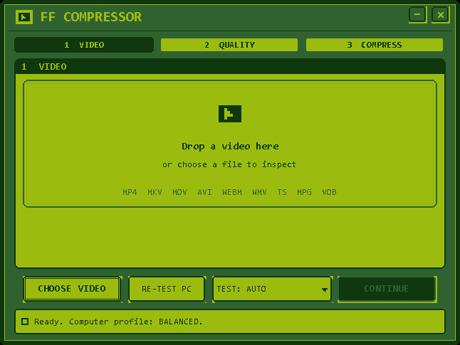

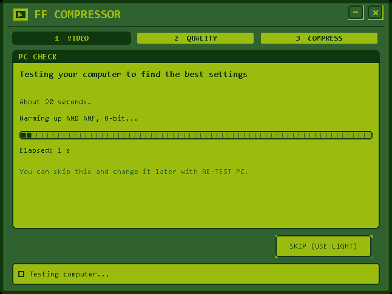

### 1. Choose a video

Drop a video onto the window or choose one with `CHOOSE VIDEO`. The app reads it
with `ffprobe` and shows resolution, frame rate, bit depth, HDR, audio and track
counts. `DETAILS` opens the technical view. Press `CONTINUE` when ready.

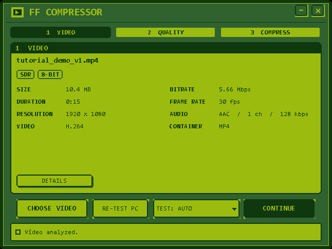

### 2. Compare quality levels

`CONTINUE` runs the sample test: several short clips at the available quality
levels. Each card shows an estimated video-only size, estimated time, video
savings and median SSIM. `TEST AGAIN` repeats the test after a confirmation; the
previous measured duration is shown.

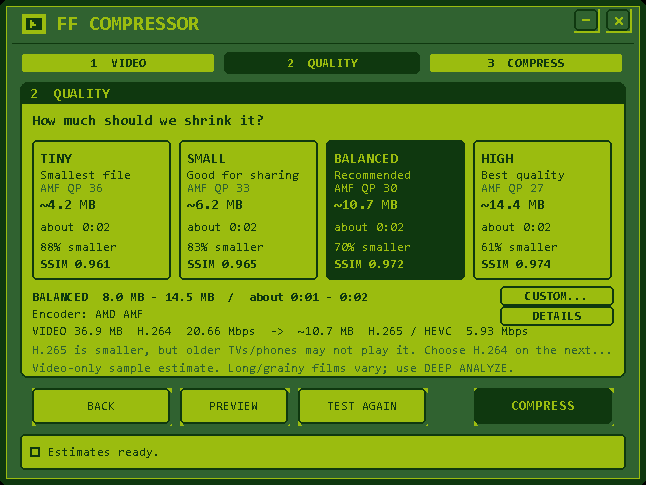

`DETAILS` shows the actual x265 CRF, QSV, NVENC and AMF value behind each preset.
`DEEP ANALYZE` re-samples long/grainy films with 4 × 6s clips instead of 3 × 4s.
The cards show video-only size; audio is added on the next screen. The
`ENCODER` chip switches between Auto, CPU x265 and any tested GPU encoder
(Intel QSV, NVIDIA NVENC, AMD AMF); changing it re-runs the preset test with
that encoder so the sizes and CRF/CQ/gq/QP values stay in sync.

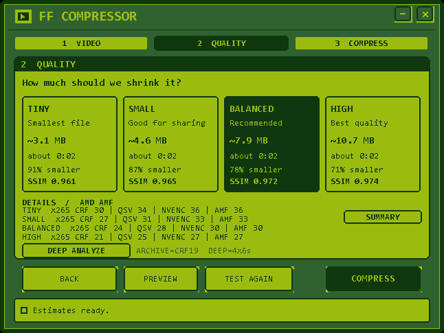

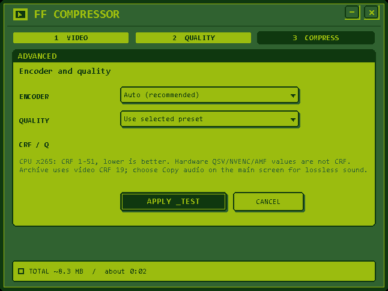

### 3. Inspect the frames

`PREVIEW` opens the two-view comparison. The original and compressed frames are
shown side by side; the level chips switch both the frame and the SSIM summary.
SSIM is guidance — the frame preview is the real judge. HDR sources are
tone-mapped to SDR for display.

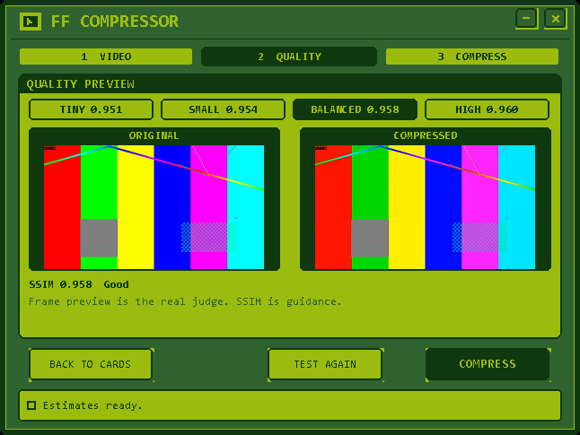

### 4. Choose output settings

`COMPRESS` opens the third step. MKV is the default container; MP4 is available
for wider device support. H.265 is the default video codec; H.264 is the
maximum-compatibility option. Audio and bitrate choices are filtered by the
container, audio tracks and subtitle tracks can be selected individually (or
dropped entirely), and the destination is shown before you start.

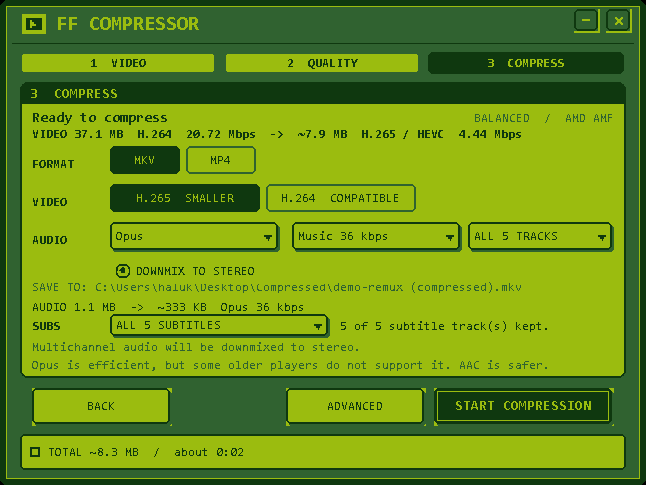

`ADVANCED` adds encoder selection (Auto/CPU x265/NVENC/QSV/AMF), preset,
`ARCHIVE` (CPU x265 CRF 19) and custom CRF. `APPLY & TEST` samples that exact
setting before updating the size/time estimate.

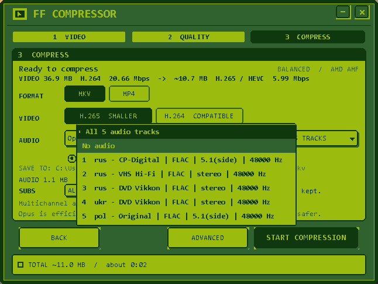

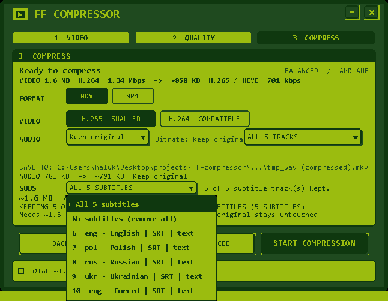

### 5. Compress

`START COMPRESSION` runs FFmpeg in the background. The progress view shows the
percentage, elapsed time, speed and the quality-step estimate. `CANCEL` stops
FFmpeg and removes the partial file.

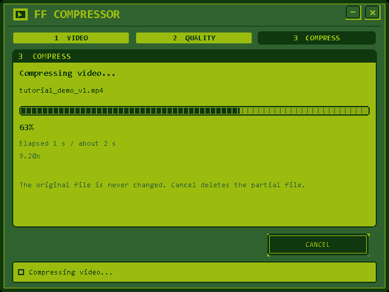

### 6. Result

The output is written to a `Compressed` folder next to the source as
`<name> (compressed).<ext>`. A `.partial` file is used until the encode passes
`ffprobe` verification, then renamed. The original file is never changed.
`OPEN FOLDER` shows the result.

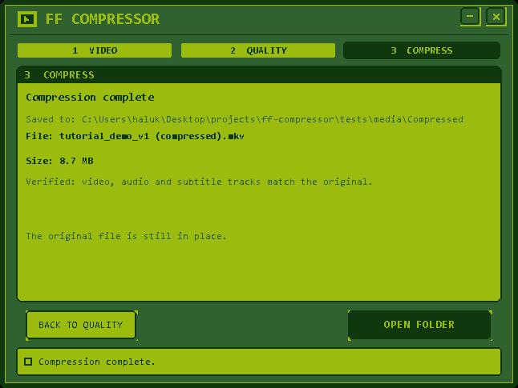

### Icon options

Ten alternative Game Boy-style icons are in
[`docs/icons/`](docs/icons/README.md), with PNG previews and multi-size ICO
files.

[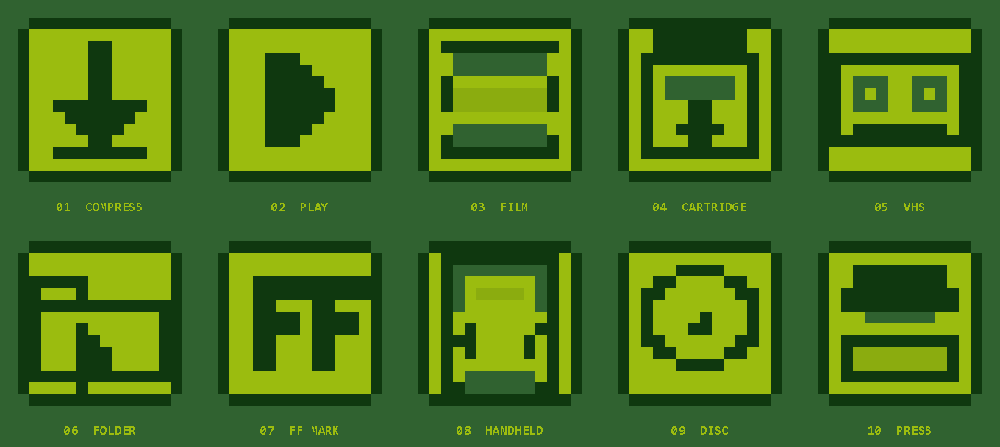](docs/icons/README.md)

## What works in M1–M6

- Choose a video with the file picker or drag and drop it onto the window.
- Read it with `ffprobe` in a background worker.
- Show codec, resolution, frame rate, VFR/CFR, bit depth, HDR/HLG/Dolby Vision,
  colour metadata, rotation, scan type, pixel aspect, average bitrate, audio
  codec/channels/sample rate, track counts and duration.
- Friendly errors for missing tools, unreadable files, timeouts and unsupported
  containers.
- Unicode paths, fixed 646×485 Game Boy layout, per-monitor DPI.
- First-launch computer test: CPU/GPU detection, FFmpeg encoder listing, and
  real 3-second encodes for NVENC, QSV, AMF and CPU x265 (8-bit, plus 10-bit
  for GPU encoders).
- One warm-up run, then three measured runs per encoder; the median is used.
  A 20% hysteresis margin keeps a stored profile stable near a threshold.
- 10-bit GPU tests write a temporary MP4, then `ffprobe` confirms the actual
  `pix_fmt` is 10-bit and the profile is Main 10. The temporary file is deleted.
- The progress screen shows the duration measured on the previous successful
  run; before the first run it shows a conservative estimate.
- The log marks an encoder as `tested_on_hardware`, `tested_failed` or
  `untested_on_hardware`. On this AMD-only development PC, NVENC and QSV are
  `untested_on_hardware`; they are tested at runtime on the user's machine.
- The log prints a `near_boundary=` note when a measured value is within 15%
  of a Light/Thorough threshold.
- Profiles: Light / Balanced / Thorough. The result is stored in
  `HKCU\Software\ff-compressor`; the app re-tests automatically when the GPU,
  driver, CPU or FFmpeg version changes.
- `RE-TEST PC` re-runs the test. `TEST: AUTO/LIGHT/BALANCED/THOROUGH` overrides
  the test depth used by per-video tests.
- `Skip` selects the Light profile immediately.
- Measurement log: `%LOCALAPPDATA%\ff-compressor\hwtest.log`.
- Quality step: 3–4 real clips from different points, 3–4 quality levels, and
  estimates for the full video size/time. The chosen encoder comes from the
  stored hardware profile; the default is H.265.
- `TEST AGAIN` re-runs the sample test for the current video after a
  confirmation that shows the previous measured duration (or a conservative
  estimate on the first run). It is cancellable and caches results for the
  current file/profile.
- Every quality level shows a median **SSIM** from its sample encodes, with a
  plain-language label (`Visually identical`, `Very good`, `Good`,
  `Visible softening`, `Low quality`). SSIM is guidance; the frame preview is
  the real judge.
- `PREVIEW` opens a two-view layout with the original and compressed frames
  side by side, level chips that switch both the frame and the SSIM summary,
  and `BACK TO CARDS`. Frames are extracted by FFmpeg at the first sample
  position. HDR10/HLG sources are tone-mapped to SDR for display and carry an
  on-screen note.
- Estimate ranges are shown as guidance. Results are verified against real
  footage in `tests/REAL-MEDIA.md`. On the M4 set (5 clips × 4 levels = 20
  checks), size error was **+2.1% to -11.0%**. 19 of 20 time checks were inside
  ±30% (range **-30.7% to +9.1%**); the one borderline case was Sintel at
  Balanced (-30.7%), where the full encode finished slightly faster than the
  conservative sample model predicted. It is reported rather than hidden.
- The quality-demo label shows a conservative range before the first run and the
  previous measured duration on repeat runs. `TEST AGAIN` keeps the same
  SSIM/preview path, so a re-test refreshes all displayed values.
- Preview bitmaps live in the per-run demo directory and are removed when the
  video changes, the estimate is reset, or the window closes.
- NVENC/QSV are tested at runtime on the user's machine. On the AMD-only
  development PC they are marked `untested_on_hardware`; a failing GPU encoder
  falls back to CPU x265 for both the estimate and the real encode, with a
  clear status message. 10-bit SDR and HDR sources only offer encoders that
  passed the 10-bit test.
- Compression step: MKV is the default container; MP4 is selectable. H.265 is
  the default video codec and uses the tested hardware encoder with CPU x265
  fallback. H.264 is always CPU x264 for maximum compatibility. HDR sources
  encoded as H.264 are tone-mapped to SDR and tagged BT.709.
- The `ADVANCED` panel overrides the encoder and quality: Auto, CPU x265,
  NVIDIA NVENC, Intel QSV or AMD AMF, plus preset, `ARCHIVE` (CPU x265 CRF 19)
  or a custom CRF/quality value. Choosing ARCHIVE also switches the video codec
  to H.265 so the label and the command agree. Applying a changed setting runs a
  short sample test for that exact encoder/quality and updates the size/time
  estimate before compression starts. Hardware quality numbers are not CRF; the
  panel says so.
- The quality screen has a `DETAILS` view that lists the actual CRF/QSV/NVENC/AMF
  value behind every preset, and a `DEEP ANALYZE` action that samples 4 x 6s
  clips instead of the normal 3 x 4s for long or grainy films.
- Estimates are video-only on the quality screen. The UI shows the real source
  video size/codec/bitrate and the target size/codec/bitrate, e.g.
  `VIDEO 36.56 GB H.264 29.88 Mbps -> ~8.2 GB HEVC 6.3 Mbps`. Audio is accounted
  for on the compress screen, where the same source -> target breakdown is shown
  for the selected audio tracks.
- Audio choices are filtered by container and kept in the requested order:
  Copy, Opus (default), AAC, MP3, FLAC, AC-3, E-AC-3, Vorbis. MP4 hides Opus,
  FLAC and Vorbis. Bitrates are Voice 24k / Music 36k / High 64k / Custom, with
  no bitrate for Copy or FLAC. A custom value can be typed directly (16–512
  kbps; 64 kbps minimum for AC-3/E-AC-3 and 32 kbps for Vorbis). The Opus
  compatibility note stays visible for MKV.
- Audio tracks are selectable on the compress screen. `ALL n TRACKS` keeps
  every track, `NO AUDIO` drops all of them, and the track menu lists each
  stream with its language/title, codec, channel layout and bitrate, so e.g.
  only the original Polish 5.1 track can be kept. Selection drives explicit maps
  and per-stream encoder options. A track is copied only when its source codec
  already matches the requested codec and no stereo downmix was requested; a
  24 kbps AAC track selected as Opus is re-encoded to Opus, not passed through.
  Multichannel tracks that are being re-encoded are proposed for stereo downmix
  (on by default; MP3/AC-3/E-AC-3 always use stereo). Copy and FLAC keep their
  channels.
- Subtitle tracks are selectable too: `ALL n SUBTITLES`, `NO SUBTITLES` or a
  single track. MKV copies supported text/bitmap codecs and converts unsupported
  text such as `mov_text` to SRT; MP4 converts selected text tracks to
  `mov_text` and drops selected bitmap tracks (with confirmation).
- Opus/Vorbis receive an encoder-safe channel layout and 48 kHz output. This
  fixes `libopus` aborting with `Invalid channel layout 5.1(side)` or
  `7.1(wide)` when surround is kept instead of downmixed, and the 96 kHz Vorbis
  encoder setup failure.
- If the source has several moving-picture streams, a `VIDEO n/m` menu appears
  and the chosen stream is mapped by its absolute ffprobe index. Cover art
  (`attached_pic`) is never selected as the primary video.
- Output goes to a `Compressed` folder next to the source. The name is
  `<name> (compressed).<ext>` with a numeric suffix if it already exists. The
  original file is never written to or overwritten. FFmpeg writes a `.partial`
  file first; it is renamed only after a successful encode.
- After encoding, `ffprobe` verifies the output: video and duration exist, the
  display resolution and the planned audio/subtitle track counts match, the
  requested audio codecs were produced, and no `mov_text` stream ended up in
  MKV. A failed verification deletes the partial output and reports an error.
- The progress view shows percentage, elapsed time, speed and the quality-step
  time estimate. `CANCEL` stops FFmpeg and deletes the partial file.
- Explicit stream maps are used (selected video by absolute index, selected
  audio by absolute index, selected subtitles), with metadata and chapters
  copied and data streams dropped.

All three steps are active. The release package is built with
`tools\make-release.ps1`.

## Requirements

- Windows 10 or 11, x64.
- MinGW-w64 GCC with `windres` (the project was built with MSYS2 MinGW).
- 7-Zip (only for extracting the pinned FFmpeg archive).
- Internet access once, to fetch FFmpeg.

## Build from source

```cmd
tools\fetch-ffmpeg.ps1
build.bat
test.bat
```

`tools\fetch-ffmpeg.ps1` downloads a pinned **static GPLv3** FFmpeg 9.0.2
full build from gyan.dev, verifies its SHA256, and copies only
`bin\ffmpeg.exe` and `bin\ffprobe.exe` into the project. `bin/` is not tracked
by git.

The executable is written to `dist\ff-compressor.exe`. The build fails if the
executable exceeds 1 MB.

## Release package

```cmd
tools\make-release.ps1
```

This requires a clean git tree and a current `dist\ff-compressor.exe`. It
creates `dist\ff-compressor-1.0.0-win64\` containing:

- `ff-compressor.exe` and the portable `bin\ffmpeg.exe` / `bin\ffprobe.exe`
- `LICENSE`, `THIRD_PARTY_NOTICES.md`, `README.md`
- `licenses\FFmpeg-BUILD.txt` and `bin\FFMPEG_BUILD.txt`
- `SOURCE.txt` with the exact commit and build instructions
- `source.zip` (complete tracked source for this release)
- `SHA256SUMS.txt`

## Hardware test harness

`tests\hwtest_cli.c` runs the same `hw_run_test()` as the UI without opening a
window. It prints the per-run speeds, medians, chosen profile and appends the
same log entry:

```cmd
gcc -std=c11 -O2 -municode -DUNICODE -D_UNICODE -D_WIN32_WINNT=0x0A00 ^
    -Isrc tests\hwtest_cli.c src\hw.c src\util.c src\strings.c ^
    -o tests\build\hwtest_cli.exe ^
    -lole32 -luuid -ldxguid -lshell32 -ladvapi32 -lgdi32 -luser32

tests\build\hwtest_cli.exe 3
```

The capability-test settings are fixed in `src/hw.c` and logged verbatim.

## Test media

`tools\make-test-media.ps1` creates synthetic clips in `tests\media\`
(gitignored):

- normal 1080p H.264/AAC,
- old low-bitrate 480p AVI,
- interlaced 576i,
- variable frame rate 720p,
- subtitled MKV,
- portrait/rotated MP4,
- 10-bit HDR10-style HEVC,
- high-bitrate 4K phone-style MP4.

They are generated with FFmpeg's `testsrc2` and `sine` sources; no third-party
media is included.

## M5 encode verification

`tests\encode_check.c` runs the same `encode_run()` path as the UI and probes the
result. The M5 matrix covered:

- MKV and MP4 output, with H.265 and H.264.
- Audio Copy, Opus, AAC, MP3, FLAC, AC-3, E-AC-3 and Vorbis, including the
  MP4 container filter and the same-codec copy rule.
- Multiple audio tracks and a 5.1 source with stereo downmix.
- Text subtitle copy in MKV, `mov_text` conversion for MP4, and `mov_text` to
  SRT conversion when an MP4 source is written to MKV.
- HDR10 to H.265 (10-bit/HDR preserved) and HDR10 to H.264 (BT.709 tone-map).
- VFR, anamorphic, rotated, 1080p and 4K sources.
- Repeated encodes (numeric suffix, no overwrite) and cancellation (partial
  file removed).

Real 4K HDR10 HEVC was re-encoded to a 10-bit HEVC output with BT.2020/PQ tags
intact; real 1080p HDR10 was also written to MP4 with `hvc1`. The current app
build is **468.5 KB**, and the core suite passes **612 tests**.

## M7 release validation

- Version metadata is **1.1.0** in the executable, manifest and window.
- `tools\make-release.ps1` builds `dist\ff-compressor-1.1.0-win64\` from a
  clean commit, including the app, pinned FFmpeg, licences, notices, checksums,
  `source.zip` and the `docs\` folder used by this README.
- All release checksums verify against `SHA256SUMS.txt`.
- The packaged EXE was run from the release folder and completed full
  compressions using its own `bin\ffmpeg.exe` and `bin\ffprobe.exe`:
  a synthetic AAC clip and a real 1080p 60 fps HEVC10 clip. Both outputs were
  probed and verified.
- The real 4K HDR10 clip was also re-encoded to 10-bit HEVC with BT.2020/PQ
  metadata intact.
- Phone-specific scenarios (real 4K HEVC HDR10/HLG/Dolby Vision, portrait
  rotation, high-fps and multi-audio phone clips) remain pending until real
  phone footage is supplied in `tests/media/phone/`.

## Design

The interface follows the same Game Boy DMG language as `ff-dlp-viewer`: four
green shades, 1 px dither, stepped pixel corners, hard 2 px frames/shadows,
`Consolas` with anti-aliasing off, owner-drawn controls, and a fixed
646×485 client area. All user-visible text is stored in `src/strings.c`.

## Privacy

No telemetry, no network calls from the application. FFmpeg runs locally on the
file you choose.

## License

GPL-3.0-or-later. See `LICENSE`.

Bundled FFmpeg is GPLv3. Build source, checksum and notices are in
`THIRD_PARTY_NOTICES.md` and `licenses/FFmpeg-BUILD.txt`.
