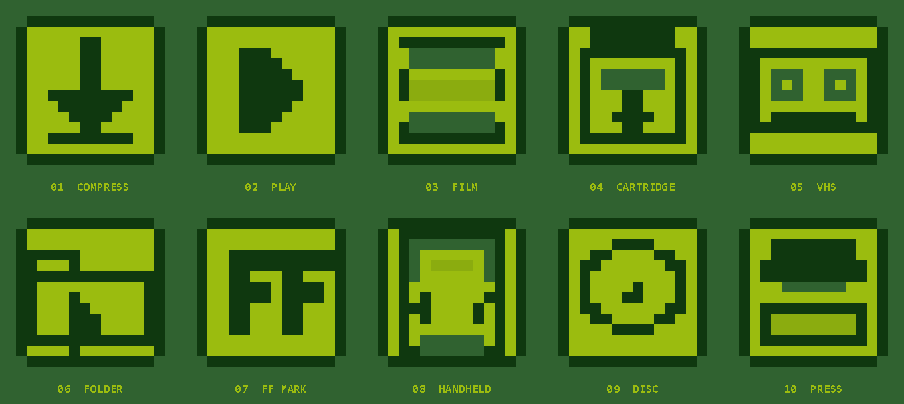

# Icon alternatives

Ten Game Boy-style icon options, generated by `tools\make-icons.ps1` from the
same four-colour DMG palette used by the interface.



Each option ships as:

- `icon-NN-name.png` — 256×256 preview
- `icon-NN-name.ico` — multi-size Windows icon (16, 32, 48, 64, 128, 256)

| # | Name | Idea |
|---|---|---|
| 01 | Compress | Downward arrow into a tray |
| 02 | Play | Play triangle in a frame |
| 03 | Film | Film strip |
| 04 | Cartridge | Game cartridge with a down arrow |
| 05 | VHS | VHS cassette with two reels |
| 06 | Folder | Folder with a play mark |
| 07 | FF Mark | Pixel “FF” monogram |
| 08 | Handheld | Game Boy-style handheld |
| 09 | Disc | Optical disc |
| 10 | Press | Compression press |

## Using one

The shipped app still uses `res\app.ico`. To try an alternative:

```cmd
copy /Y docs\icons\icon-01-compress.ico res\app.ico
build.bat
git checkout -- res\app.ico
```

Change the number to the option you want. The PNGs are for review only; the ICO
files are what Windows uses for the executable and taskbar.

`res\app.ico` is tracked, so the final `git checkout` restores the shipped icon
and keeps the working tree clean for `tools\make-release.ps1`.

The icons are GPL-3.0-or-later like the rest of the application.
